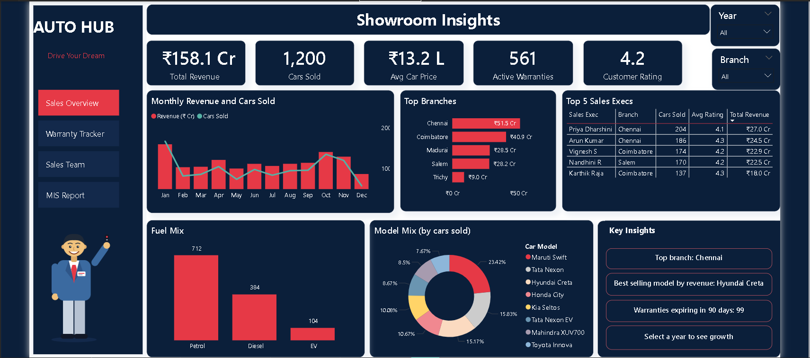
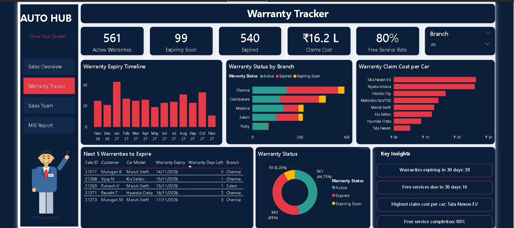
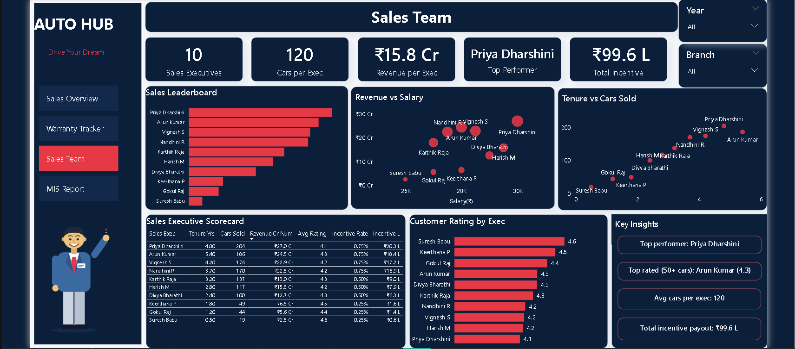
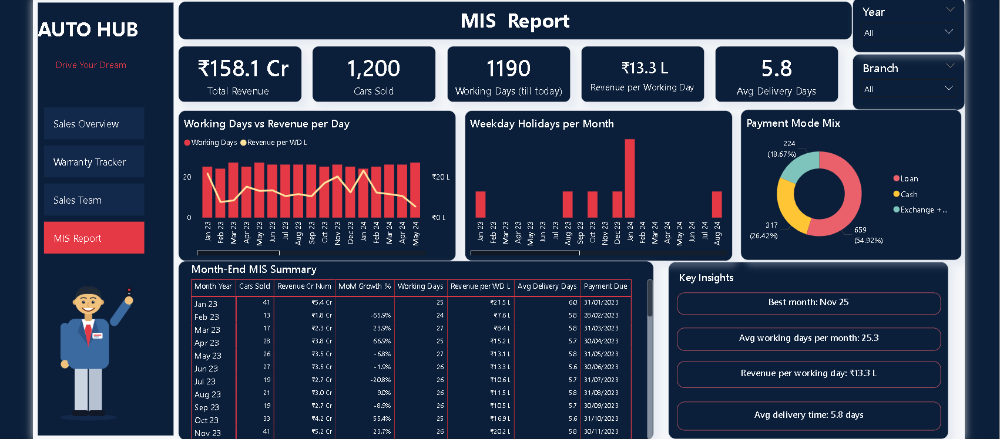

# Car Showroom Analytics Dashboard (Power BI)

An interactive 4-page Power BI dashboard for a car showroom: sales performance, warranty tracking, sales team scorecard and a month-end MIS report. Navigation sidebar, custom theme and illustrated sales executive give it an app-like feel.

> Data is synthetic (generated with Python) and used for portfolio purposes only.
## Dashboard Preview

### 1. Sales Overview

### 2. Warranty Tracker

### 3. Sales Team

### 4. MIS Report

## Pages
1. **Sales Overview**: revenue, cars sold, avg price, active warranties, monthly trend, top branches, model and fuel mix, top 5 sales executives, key insights
2. **Warranty Tracker**: Active / Expiring Soon / Expired status, 12-month expiry timeline, next 5 warranties to expire, claim cost per car, free service completion rate
3. **Sales Team**: leaderboard, revenue vs salary, tenure vs cars sold, executive scorecard with slab-based incentive
4. **MIS Report**: month-end summary, working days, revenue per working day, weekday holiday impact, delivery time, payment due date, MoM growth

## Excel Practice Stage
Before building the dashboard, I practiced date and time functions manually on a single sheet with sales, employee, warranty and holiday data:
- TODAY / NOW / DAY / MONTH / YEAR
- EDATE (warranty expiry, free service due, probation end)
- EOMONTH (payment due at month end)
- NETWORKDAYS / WORKDAY (working days, delivery date with a holiday list)
- DATEDIFF, IF, VLOOKUP (tenure, warranty status, executive lookup)
These formulas were then rebuilt in DAX for the Power BI model.

## Tech Stack
- Python (Pandas, NumPy) in Google Colab for dataset generation
- Excel for date-function practice (TODAY, NOW, EDATE, EOMONTH, NETWORKDAYS, WORKDAY)
- Power BI Desktop: Power Query, data modelling, DAX, custom JSON theme, page navigator

## Data Model
Sales (1,200 rows) | Employees | Service | Holidays | Calendar (DAX)
- Employees (1) to Sales (many) on Emp ID
- Sales (1) to Service (many) on Sale ID
- Calendar (1) to Sales (many) on date

## DAX Highlights
- Warranty Expiry, Days Left and Status (Active / Expiring Soon / Expired) using EDATE, DATEDIFF, TODAY
- Working-day logic: holiday-aware Calendar flags (NETWORKDAYS equivalent), KEEPFILTERS so month context is preserved
- Delivery Date = 5 working days after sale (WORKDAY equivalent)
- MoM growth with DATEADD, Year-over-year growth with SAMEPERIODLASTYEAR
- Slab-based incentive using SWITCH(TRUE())
- Dynamic insight text measures

## Key Insights
- Total revenue Rs 158.1 Cr from 1,200 cars; Chennai is the top branch (Rs 51.5 Cr)
- 2025 revenue grew 14.4% over 2024
- Top performer: Priya Dharshini (Rs 27.0 Cr)
- Free service completion rate: 81%; warranty claim cost tracked per car by model

## Repository Structure
- data/ : Car_Showroom_PowerBI.xlsx
- notebooks/ : data generation code (Google Colab)
- dashboard/ : Car_Showroom_Dashboard.pbix
- theme/ : CarTheme_v3.json
- screenshots/ : 4 page screenshots

## Author
Abinayaa J | LinkedIn: linkedin.com/in/abinaya-j-69549227b
